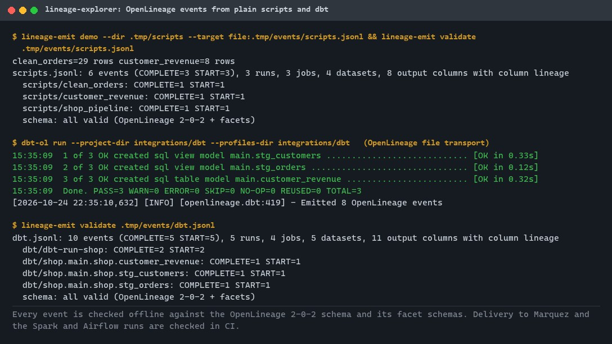
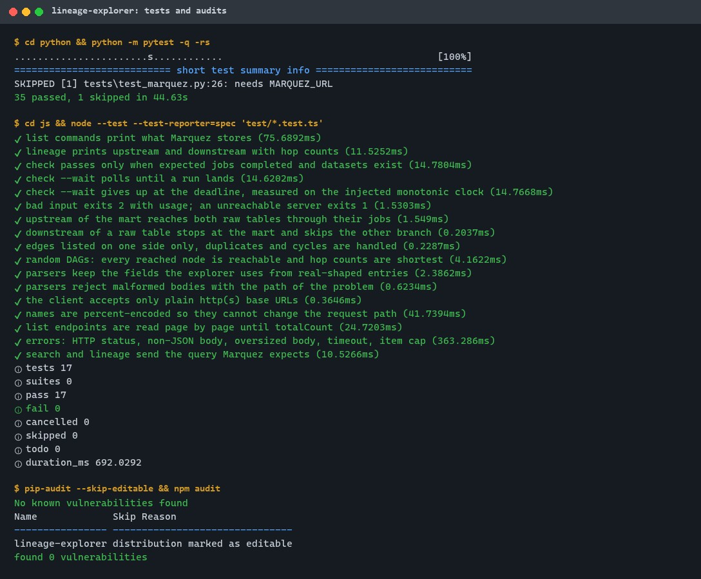
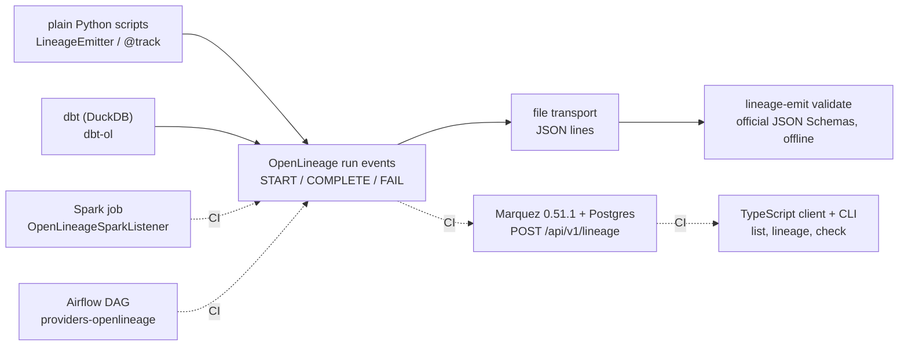
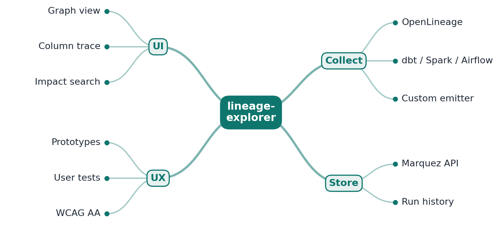

# lineage-explorer

[](https://github.com/EquinoxWN/lineage-explorer/actions/workflows/ci.yml)


> dbt and plain Python scripts report every run as OpenLineage events, checked against the official schemas, so the data behind "what breaks if I drop this column?" is collected and checked. In CI, Spark and Airflow runs report into Marquez too, and a check reads them back.

Part of my **Data Engineering** list · TypeScript · Python

## Proof it works

A plain-script pipeline and a real `dbt-ol` run on DuckDB, with their events captured and checked against the official OpenLineage schemas (0 problems; 19 output columns carry column lineage):



52 tests pass locally (35 Python, 17 TypeScript; one Marquez test runs in CI only), and both dependency audits are clean:



## Architecture

**What M1 runs today:**



**Full roadmap (M1 to M3):**



## How it works

_Steps 1 and 2 are built and tested (M1); the rest is on the [roadmap](#roadmap)._

1. dbt, Spark and Airflow emit OpenLineage events on every run; a small custom emitter covers plain scripts.
2. Marquez stores datasets, jobs and runs, and serves them through its API.
3. The React Flow UI draws the graph, collapses large subgraphs and traces a single column upstream or downstream.
4. Impact search answers 'what breaks if I drop this column?' by highlighting every affected asset and owner.
5. The UI was prototyped in Figma/Penpot first and tested with five users; their findings shaped the final layout.
6. Keyboard navigation and a colour-blind-safe palette meet WCAG AA.

In M1 the official integrations do the collecting: `dbt-ol` wraps dbt, the OpenLineage listener is added to `spark-submit`, and the Airflow OpenLineage provider is configured through environment variables, so the dbt project, Spark job and DAG contain no lineage code. Plain scripts wrap their work in `LineageEmitter.run()`, which sends START, then COMPLETE, or FAIL with the error and stack trace (and re-raises), with input and output datasets, their columns, column-level lineage and a parent-run link. `lineage-emit validate` checks any captured events against the OpenLineage 2-0-2 schema and six facet schemas shipped with the package. The TypeScript client reads Marquez's REST API with typed, bounded requests, and `check` fails unless the expected runs and datasets are stored.

## Who it helps

- **Who:** data and analytics engineers and platform teams running dbt, Spark, Airflow and ad-hoc Python jobs.
- **The problem:** lineage is spread over several tools and scripts, and nothing records what each run read and wrote in one place, so the impact of a schema change is guessed.
- **How to use it:** point the integrations at Marquez (or a file) with the settings shown in [Run it](#run-it) and the [CI workflow](.github/workflows/ci.yml); wrap plain scripts in `LineageEmitter.run()`; check captured events with `lineage-emit validate`; read what Marquez stores, or gate a pipeline on it, with `node src/cli.ts summary | lineage | check`.

## Tech stack

| Area | In M1 | Planned |
|---|---|---|
| Collect | OpenLineage 1.54.0: `dbt-ol` (dbt 1.12 on DuckDB), Spark listener (PySpark 4.0), Airflow 3.3 provider, custom Python emitter on `openlineage-python` | - |
| Check | Offline JSON Schema validation (OpenLineage 2-0-2 + facets) with `jsonschema` | - |
| Store | Marquez 0.51.1 on Postgres 16 (CI, digest-pinned images) | Run history views |
| Read | TypeScript client and CLI for the Marquez API (Node.js 24, no runtime dependencies) | React, React Flow, TanStack Query UI with column trace and impact search |
| Design | - | Figma / Penpot prototypes, 5-user usability test notes, WCAG AA |

Two parts, each in its own folder: [`python/`](python) (the emitter, the validator and the `lineage-emit` command) and [`js/`](js) (the Marquez client, graph walk and CLI). The example dbt project, Spark job and Airflow DAG are in [`integrations/`](integrations).

## Run it

**Prerequisites:** Python 3.11+, Node.js 24+, GNU make. Spark (Java 17+) and Airflow (Linux) only for those two integrations; Docker only to run Marquez.

```bash
python -m venv .venv && . .venv/bin/activate   # Windows: .venv\Scripts\activate
make setup        # pip install -e "python[dev,dbt]"; npm ci in js/
make lint         # ruff, ruff format, mypy --strict, tsc --strict
make test         # 35 Python tests (incl. a real dbt-ol run) + 17 TypeScript tests
make audit        # pip-audit and npm audit
make demo         # two CSV scripts -> events in .tmp/events/scripts.jsonl, then validated
make dbt-events   # dbt-ol seed + run on DuckDB -> .tmp/events/dbt.jsonl, then validated
```

With a Marquez server (the CI workflow shows the exact `docker run` commands and digests):

```bash
export OPENLINEAGE_URL=http://localhost:5000 MARQUEZ_URL=http://localhost:5000
lineage-emit demo --dir .tmp/scripts                        # custom emitter, HTTP transport
OPENLINEAGE_NAMESPACE=dbt dbt-ol run --project-dir integrations/dbt --profiles-dir integrations/dbt
cd js
node src/cli.ts summary                                     # datasets, jobs, latest run states
node src/cli.ts lineage "dataset:file:/abs/path/marts/customer_revenue.csv"
node src/cli.ts check --job dbt::customer_revenue --dataset shop.main.customer_revenue --wait 60
```

Spark and Airflow use only configuration: `spark-submit --packages io.openlineage:openlineage-spark_2.13:1.54.0 --conf spark.extraListeners=io.openlineage.spark.agent.OpenLineageSparkListener --conf spark.openlineage.transport.type=http ...`, and `AIRFLOW__OPENLINEAGE__TRANSPORT` / `AIRFLOW__OPENLINEAGE__NAMESPACE` for Airflow (full commands in the `marquez` CI job).

## Tests and results

Full commands, numbers and the DMAIC record: [docs/results/m1.md](docs/results/m1.md). Quality check of the 10 engineering rules, with a mutation test of the core functions: [docs/quality/2026-11-01.md](docs/quality/2026-11-01.md).

| Test file | Tests | What it proves |
|---|---|---|
| `python/tests/test_emitter.py` | 16 | START then COMPLETE per run; FAIL with error and stack trace on an exception, which is re-raised; schema, column-lineage, job-type and parent facets; decorator; name and target validation; file transport; HTTP POSTs to `/api/v1/lineage` on an in-process stub |
| `python/tests/test_validate.py` | 12 | Valid events pass; 7 single-field violations are reported at their path; custom facets; bounded JSON-lines reading; summary counts |
| `python/tests/test_demo.py` | 4 | The CSV scripts compute correct totals and emit 6 valid events in order; a failing script yields FAIL; `lineage-emit` exit codes |
| `python/tests/test_dbt.py` | 3 | Real `dbt-ol seed` + `run` on DuckDB: one START and COMPLETE per model, all events valid, inputs, outputs and column lineage follow the SQL |
| `python/tests/test_marquez.py` | 1 (CI) | Custom emitter to a real Marquez; job, run, inputs, outputs, fields and lineage read back through the API |
| `js/test/marquez.test.ts` | 7 | Typed parsing, URL and encoding safety, paging, size, time and item limits, error statuses |
| `js/test/graph.test.ts` | 4 | Upstream and downstream walks, one-sided edges, cycles; 25 random DAGs match shortest-path hop counts |
| `js/test/cli.test.ts` | 6 | List, summary and lineage output; `check` pass, miss, `--wait` and its deadline on a monotonic clock; exit codes 2 for usage and 1 for server errors |

| Check | Result |
|---|---|
| Tests | **52 passed** locally (Python 35, TypeScript 17), 1 skipped (needs Marquez, runs in CI), 0 failed |
| Captured events | scripts 6 and dbt 10 events, **0 schema problems**, 19 output columns with column lineage |
| Lint / types | ruff, ruff format, `mypy --strict`, `tsc --strict`: clean |
| Audit | `pip-audit`: no known vulnerabilities; `npm audit`: 0 vulnerabilities |
| CI only | Marquez storage and API, Spark listener and Airflow provider runs (`marquez` job); not yet run on GitHub |

## Roadmap

**M1** (≈8 h)
- [x] Write `docs/rfc/0001-design.md`: problem, goals, non-goals, chosen design
- [x] dbt, Spark and Airflow emit OpenLineage events on every run; a small custom emitter covers plain scripts. dbt and scripts run and are validated locally; Spark and Airflow run in the CI `marquez` job.
- [x] Marquez stores datasets, jobs and runs, and serves them through its API. In CI the typed client's `check` found all 12 expectations met: 9 jobs completed and 3 datasets stored.

**M2** (≈8 h)
- [ ] The React Flow UI draws the graph, collapses large subgraphs and traces a single column upstream or downstream.
- [ ] Impact search answers 'what breaks if I drop this column?' by highlighting every affected asset and owner.

**M3** (≈9 h)
- [ ] The UI was prototyped in Figma/Penpot first and tested with five users; their findings shaped the final layout.
- [ ] Keyboard navigation and a colour-blind-safe palette meet WCAG AA.
- [ ] Publish the proof below with real numbers

## Proof

What this repo must show before it counts as done:

- A design case study: prototype, test findings, and before/after screens.

| Result | Value |
|---|---|
| M3 proof above | Not done yet (M3). Current M1 numbers: see [Tests and results](#tests-and-results). |

## Why it matters

- **Interview angle:** 'Impact analysis across a data platform'.
- **Upstream I'm contributing to:** OpenLineage or Marquez.

## Design docs

- [RFC 0001: design](docs/rfc/0001-design.md)
- [ADR 0001: record architecture decisions](docs/adr/0001-record-architecture-decisions.md)
- [ADR 0002: build the script emitter on openlineage-python and validate offline](docs/adr/0002-build-on-openlineage-python-and-validate-offline.md)
- [ADR 0003: read raw tables as dbt sources, not seed refs](docs/adr/0003-raw-tables-as-dbt-sources.md)
- [M1 results](docs/results/m1.md)

## Scope

This is a learning and portfolio system, not a hosted production service. Everything runs locally or in CI; Marquez has no authentication here and should not be exposed.

## Security and contributing

- Every GitHub Action is pinned to a commit SHA, container images are pinned by digest and memory-capped, and workflows run read-only without persisted credentials.
- Dependabot update pull requests are paused (`open-pull-requests-limit: 0`) so the repository keeps a single `main` branch; dependencies are updated by hand and checked by `pip-audit` and `npm audit` in CI.
- Inputs are bounded: names are checked before emitting, targets must be `file:`, `console` or http(s), event files are read with line and count limits, and the client percent-encodes names and caps response size, time and item count.
- Report vulnerabilities privately: see [SECURITY.md](SECURITY.md). To contribute, see [CONTRIBUTING.md](CONTRIBUTING.md).

## License

MIT, see [LICENSE](LICENSE). The OpenLineage JSON Schemas in `python/src/lineage_explorer/schemas/` are Apache-2.0 (see the NOTICE file there).
